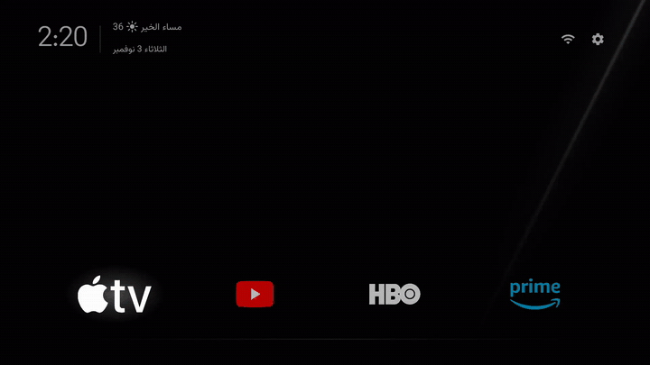
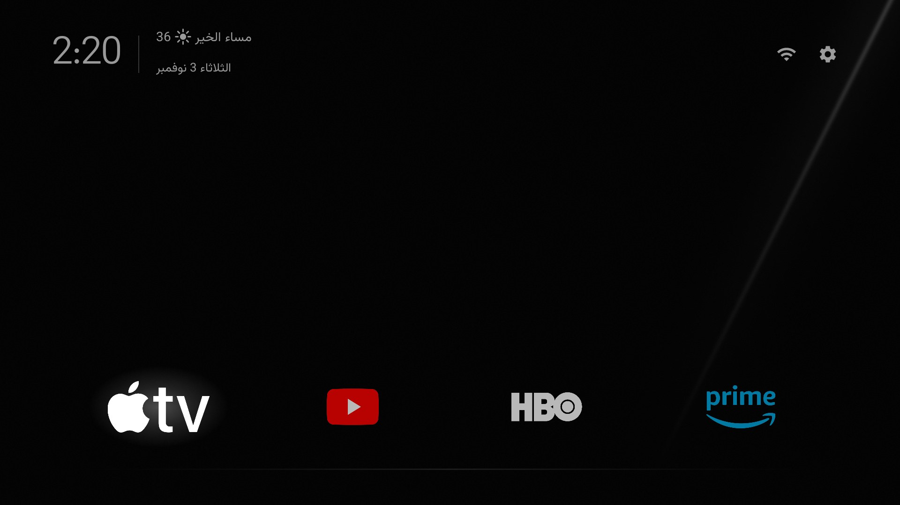
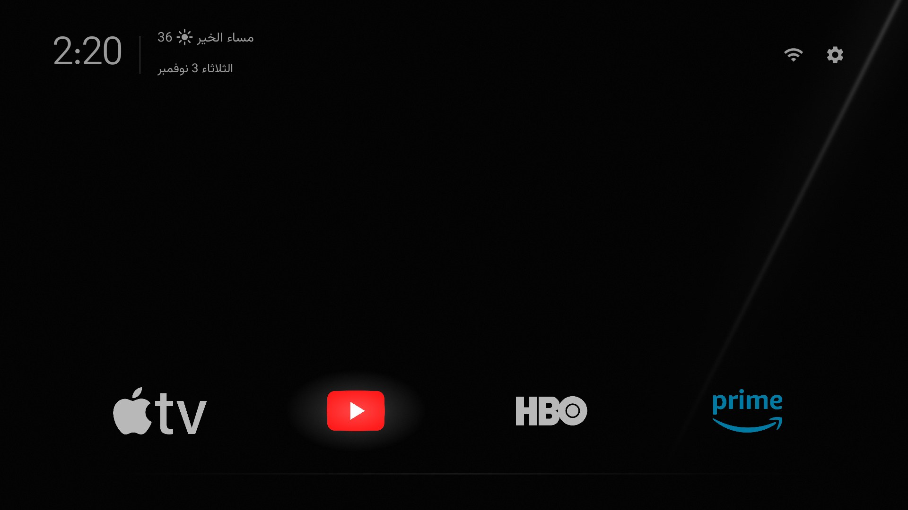
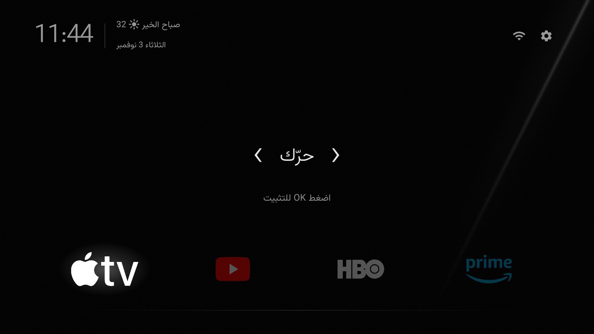
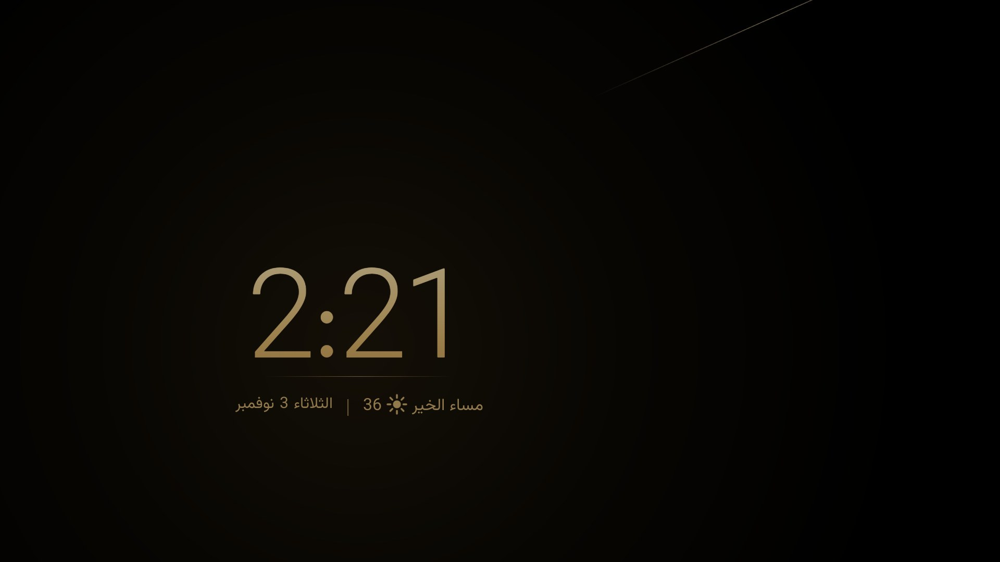
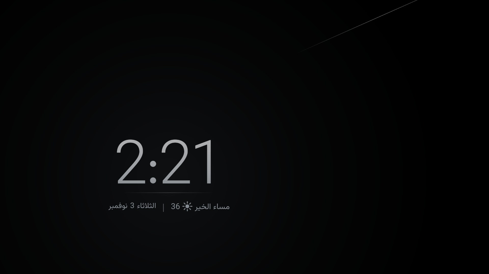

<div dir="rtl">

<p align="center">
  
</p>

<p align="center">
  <b>واجهة رئيسية فاخرة وهادئة وشاشة توقف بساعة لأجهزة Android TV وGoogle TV.</b><br>
  أسود، وشعارات بدون إطارات، ووهج أبيض ناعم. بدون إعلانات ولا ترشيحات ولا تتبع.
</p>

<p align="center">
  <a href="https://github.com/esamyo/luxury-tv/releases/latest"></a>
  <a href="https://github.com/esamyo/luxury-tv/releases"></a>
  
  
  <a href="LICENSE"></a>
</p>

<p align="center">العربية · <a href="README.md">English</a></p>

<p align="center"></p>

| الشاشة الرئيسية | التحديد |
|---|---|
|  |  |
| **نقل تطبيق** | **شاشة التوقف** |
|  |  |

<sub>لقطات وفيديو حقيقية من جهاز Xiaomi TV Box S (الجيل الثالث)، بشعارات أضافها صاحب الجهاز لتطبيقاته. Luxury TV لا
يأتي بأي شعارات: يعرض كل تطبيق عندك بأيقونته، أو بشعار تضيفه أنت ([الطريقة](docs/custom-logos.md)).
الفيديو كاملًا: [luxurytv-demo.mp4](docs/media/luxurytv-demo.mp4).</sub>

## المميزات

- **هدوء وسواد.** أسود صافٍ مع خط ضوء رفيع واحد، وخط خافت تحت التطبيقات.
- **شعارات بدون إطارات.** كل تطبيق بشعاره فقط وخافت قليلًا، واللي تقف عليه يكبر ويضيء ووراءه وهج أبيض ناعم
  ينتقل معك من تطبيق لتطبيق.
- **رأس متناسق.** الساعة والتحية والتاريخ بلون رمادي واحد هادئ، مع علامتي الواي فاي والإعدادات بدون دوائر.
- **تحية تعرف مكانك.** بلغتك وفي الأوقات المعروفة عند أهلها، مع درجة الحرارة وأيقونة الطقس من أقرب مطار لمدينتك.
- **نقل التطبيقات بالريموت.** اضغط مطوّلًا على OK (أو زر Menu)، وحرّك التطبيق بالأسهم، ثم OK. الترتيب يبقى محفوظًا.
- **شاشة توقف بساعة ذهبية وفضية.** ذهبية بالنهار وفضية بالليل، وتتبدل مع شروق الشمس وغروبها في مدينتك.
  وزر الرجوع في الشاشة الرئيسية يفتحها مباشرة.
- **خفيفة.** 0.32 ميجابايت للواجهة وشاشة التوقف معًا. شاشة التوقف داخل الواجهة نفسها، فلا تأخذ ذاكرة إضافية.
- **31 لغة،** مع خط Vazirmatn مرفق للعربية والفارسية والأردية والحروف اللاتينية.

## المتطلبات

- جهاز Android TV أو Google TV بنظام Android 8.0 أو أحدث.
- لضبطها كواجهة رئيسية وشاشة توقف (مرة واحدة): كمبيوتر على نفس الشبكة عليه [adb](https://developer.android.com/tools/releases/platform-tools)
  (أدوات Android platform-tools).
- في التلفزيون: الإعدادات ← حول ← اضغط **رقم الإصدار** سبع مرات، ثم من خيارات المطور فعّل **تصحيح الأخطاء عبر
  الشبكة (ADB)**، وسجّل عنوان التلفزيون (IP).

جُرّبت على Xiaomi TV Box S الجيل الثالث (Google TV، أندرويد 14، ذاكرة 2 جيجابايت)، والمفروض تشتغل على أي Android TV.
إذا تصرّف جهازك بشكل مختلف، [افتح بلاغًا](https://github.com/esamyo/luxury-tv/issues/new/choose).

## التثبيت

**دليل التثبيت خطوة بخطوة بالصور: [docs/install.md](docs/install.md)**

### الطريقة 1: من التلفزيون عبر Downloader (بدون كمبيوتر)

1. في التلفزيون، ثبّت تطبيق **Downloader** من AFTVnews من متجر Google Play.
2. افتحه واكتب الكود **`3190694`** (أو `is.gd/luxurytv`) في خانة العنوان واضغط Go. ينزّل آخر إصدار من
   Luxury TV؛ اختر **Install**.
3. افتح **Luxury TV** من قائمة التطبيقات.

لتصير الواجهة الرئيسية وشاشة التوقف تحتاج كمبيوتر مرة واحدة: آخر أمرين تحت *بدون السكربتات* في الطريقة 2.

### الطريقة 2: تنزيل ملف APK على الكمبيوتر

1. نزّل [`luxurytv.apk`](https://github.com/esamyo/luxury-tv/releases/latest/download/luxurytv.apk) ونزّل هذا المستودع (Code ← Download ZIP) للسكربتات والثيم.
2. ثبّته واجعله الواجهة الرئيسية واضبط شاشة التوقف:
   ```powershell
   tools\install.ps1 192.168.1.50 -Apk luxurytv.apk      # Windows
   ```
   ```sh
   tools/install.sh 192.168.1.50 luxurytv.apk            # macOS و Linux
   ```
3. اكتب مدينتك ولغتك في `themes/luxury/config.json` (انظر [الإعدادات](#الإعدادات))، ثم طبّق الثيم:
   ```powershell
   tools\theme.ps1 192.168.1.50 themes\luxury            # أو tools/theme.sh
   ```
4. اضغط زر الرئيسية في الريموت.

<details>
<summary>بدون السكربتات</summary>

```sh
adb connect 192.168.1.50:5555
adb install -r luxurytv.apk
adb shell cmd package set-home-activity --user 0 com.esamyo.luxurytv/.MainActivity
adb shell settings put secure screensaver_components com.esamyo.luxurytv/.ClockDream
```
</details>

كل إصدار يُبنى ويُوقَّع على GitHub من هذا المصدر. بصمة SHA-256 لشهادة التوقيع:
`D2:CC:3F:8D:5A:86:57:5D:E5:99:8A:4F:04:65:9D:DD:FA:A0:E3:B9:93:3E:8B:47:59:D7:AB:86:81:F9:0C:50`، وكل إصدار
فيه بصمة الملف نفسه (`luxurytv.apk.sha256`).

### الطريقة 3: البناء من المصدر

تحتاج [Android Studio](https://developer.android.com/studio) (فيه JDK 17 وAndroid SDK بالإصدار 34). عدّل
`launcher/app/src/main/res/values/config.xml` إذا تبغى، ثم شغّل `tools\install.ps1 192.168.1.50`
(أو `tools/install.sh 192.168.1.50`): يبني ويثبّت ويضبط الواجهة الرئيسية وشاشة التوقف.

### الطريقة 4: اطلب من مساعد ذكاء اصطناعي

افتح أي مساعد ذكاء اصطناعي يقدر يشغّل أوامر على جهازك، داخل مجلد هذا المشروع، وقل له:

> ركّب Luxury TV على تلفزيوني من هذا المشروع. عنوان التلفزيون 192.168.1.50، وأنا في الرياض. اقرأ AGENTS.md أولًا.

يمشي مع [AGENTS.md](AGENTS.md) ويسألك قبل أي خطوة تغيّر في التلفزيون.

## الإعدادات

ملف `config.json` في الثيم يغيّر Luxury TV بدون إعادة بناء، و`config.xml` فيه نفس المفاتيح لمن يبني من المصدر.
كل المفاتيح اختيارية.

| المفتاح | وظيفته | مثال |
|---|---|---|
| `locale` | لغة الواجهة. إذا تركته فارغًا تتبع لغة التلفزيون | `"ar-SA-u-nu-latn"` (العربية بأرقام إنجليزية) |
| `latitude` و `longitude` | إحداثيات مدينتك: منها الطقس من أقرب مطار، وشروق الشمس وغروبها لشاشة التوقف. إذا تركتها فارغة فلا طقس ولا اتصال بالإنترنت | `"24.71"` و `"46.68"` |
| `weather_metar` | مطار معيّن (رمز ICAO) بدل أقرب مطار | `"OERK"` |
| `dock_apps` | تطبيقات الصف الرئيسي بأسماء حزمها وبترتيبها | `["org.videolan.vlc"]` |
| `hidden_apps` | تطبيقات لا تظهر في الشاشة الرئيسية | `["com.example.tvguide"]` |
| `clock_style` و `clock_style_night` | ألوان شاشة التوقف: `gold` أو `silver` أو `glow` | `"gold"` و `"silver"` |
| `clock_format` | `"12"` أو `"24"` أو `"system"` | `"24"` |
| `back_opens_clock` | زر الرجوع في الشاشة الرئيسية يفتح شاشة التوقف | `true` |
| `wallpaper` | إظهار خلفية الثيم `wallpaper.jpg` | `true` |

الساعة والتاريخ والمنطقة الزمنية من التلفزيون نفسه (الإعدادات ← النظام ← التاريخ والوقت). وأسماء الحزم:
`adb shell pm list packages -3`.

## شعاراتك

ضع صورة PNG بخلفية شفافة باسم `logo_<اسم الحزمة>.png` في `launcher/app/src/main/res/drawable-nodpi/` وأعد البناء:
`org.example.player` ← `logo_org_example_player.png`. التفاصيل في [docs/custom-logos.md](docs/custom-logos.md).

Luxury TV لا يوزّع شعارات أي علامة تجارية، وأي شعار تضيفه يكون لجهازك الشخصي وعلى مسؤوليتك.

## شاشة التوقف

| النهار | الليل |
|---|---|
|  |  |

ساعة كبيرة على أسود، ذهبية بالنهار وفضية بالليل، وتحتها خط رفيع وسطر واحد: التحية مع الطقس في جهة والتاريخ في
الجهة الثانية. كل 3 دقائق تختفي الساعة ببطء وترجع في مكان جديد، وخط الضوء ينتقل للزاوية البعيدة، فلا يثبت شيء على
الشاشة ويحرقها.

قياس فعلي على Xiaomi TV Box S (ذاكرة 2 جيجابايت) مقارنة بـ Aerial Views:

| | Aerial Views | ساعة Luxury TV |
|---|---|---|
| الذاكرة أثناء التشغيل | 118 إلى 128 ميجابايت | لا زيادة: تشتغل داخل الواجهة |
| الذاكرة المتاحة للنظام | تنقص 80 إلى 125 ميجابايت | لا تنقص |
| الحجم | 14.5 ميجابايت | ضمن 0.32 ميجابايت للواجهة كلها |
| الإنترنت | فيديو متواصل | قراءة طقس واحدة كل نصف ساعة |

لاختيار شاشة توقف أخرى: الإعدادات ← الشاشة ← شاشة التوقف.

## زر الرئيسية في ريموت شاومي

بعض ريموتات شاومي ترسل زرًا لا تفهمه إلا الواجهة الأصلية، فإذا تعطّلت ما يسوي زر الرئيسية شيئًا. Luxury TV فيه أداة
صغيرة لهذا، فعّلها فقط إذا احتجتها (تحل محل أي خدمة إمكانية وصول أخرى مفعّلة):

```sh
adb shell settings put secure enabled_accessibility_services com.esamyo.luxurytv/.HomeKeyService
adb shell settings put secure accessibility_enabled 1
```

## تلفزيون أخف (اختياري)

- [docs/debloat.md](docs/debloat.md): تعطيل تطبيقات الشركة والإعلانات والتتبع بدون حذف، ويرجع كل شيء بأمر واحد.
  وفي [examples/](examples/xiaomi-mitv-afmu0/) قائمة مجرّبة لجهاز Xiaomi TV Box S.
- [docs/light-settings.md](docs/light-settings.md): إعدادات أندرويد لجهاز خفيف، والوقت والطقس لمدينتك.

## الإزالة

```sh
adb uninstall com.esamyo.luxurytv
```

إذا كنت عطّلت الواجهة الأصلية فعّلها أولًا، مثلًا في Google TV:
`adb shell pm enable --user 0 com.google.android.apps.tv.launcherx`. وترجع شاشة توقف Google TV بالأمر
`adb shell settings put secure screensaver_components com.google.android.apps.tv.dreamx/.service.Backdrop`.

## الخصوصية

Luxury TV بدون حسابات ولا إحصائيات ولا إعلانات. اتصاله الوحيد بالإنترنت للطقس، وفقط إذا حددت مدينتك: تقرير METAR من
[aviationweather.gov](https://aviationweather.gov)، و[Open-Meteo](https://open-meteo.com) احتياطًا. للإبلاغ عن مشكلة
أمنية انظر [SECURITY.md](SECURITY.md).

## المساهمة

البلاغات وطلبات الدمج مرحّب بها. اقرأ [CONTRIBUTING.md](CONTRIBUTING.md) أولًا، والتغييرات مسجلة في
[CHANGELOG.md](CHANGELOG.md).

## الحقوق والرخصة

© 2026 [esamyo](https://github.com/esamyo) (عصام). منشور برخصة [MIT](LICENSE)، وأسطر الحقوق وملف [NOTICE](NOTICE.md)
يبقيان في كل نسخة وتفرّع.

بدأ Luxury TV من [Gathin23/tv-vibehack](https://github.com/Gathin23/tv-vibehack) (MIT). وخط Vazirmatn برخصة
SIL Open Font License 1.1 (`launcher/FONT-LICENSE-VAZIRMATN-OFL.txt`).

</div>
