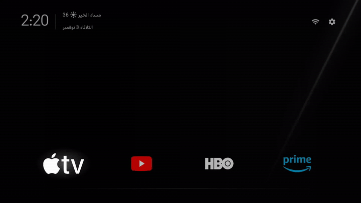
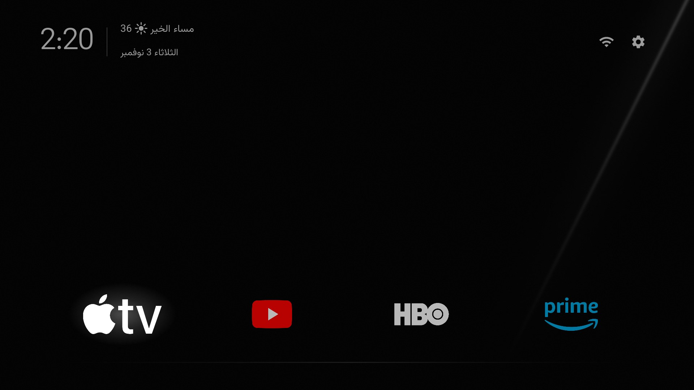
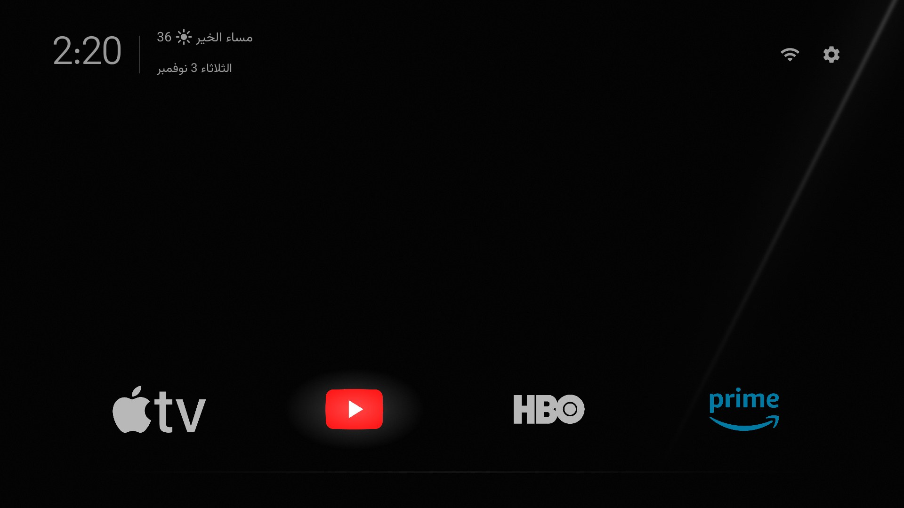
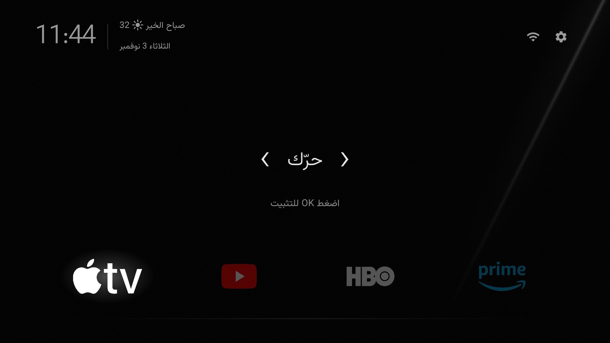
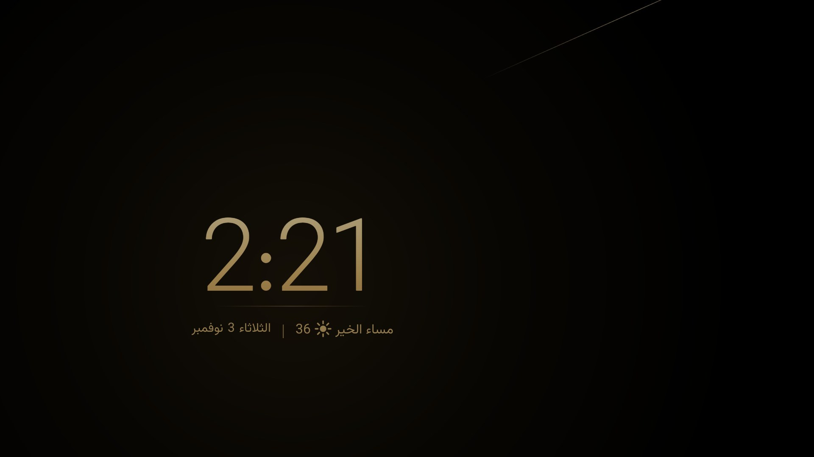
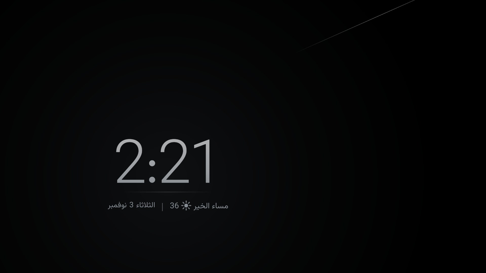

<p align="center">
  
</p>

<p align="center">
  <b>A quiet, luxurious home screen and clock screensaver for Android TV and Google TV.</b><br>
  Black, frameless logos, a soft white glow. No ads, no recommendations, no tracking.
</p>

<p align="center">
  <a href="https://github.com/esamyo/luxury-tv/releases/latest"></a>
  <a href="https://github.com/esamyo/luxury-tv/releases"></a>
  
  
  <a href="LICENSE"></a>
</p>

<p align="center"><a href="README.ar.md">العربية</a> · English</p>

<p align="center"></p>

| Home | Focus |
|---|---|
|  |  |
| **Moving an app** | **Screensaver** |
|  |  |

<sub>Real screenshots and video from a Xiaomi TV Box S (3rd gen), with logos the owner added for his own apps.
Luxury TV ships no logos: it shows each of your apps with its own icon, or with a logo you add
([how](docs/custom-logos.md)). Full video: [luxurytv-demo.mp4](docs/media/luxurytv-demo.mp4).</sub>

## Highlights

- **Calm and dark.** Pure black with one thin streak of light, and a faint line under the apps.
- **Frameless logos.** Each app is just its logo, slightly dimmed; the one in focus grows, lights up and gets a soft
  white glow that springs from app to app.
- **A matched header.** Clock, greeting and date in one soft grey, with bare Wi-Fi and Settings icons.
- **A greeting that knows where you are.** In your language, at the hours people there use it, with the
  temperature and a weather icon from the airport nearest your city.
- **Move apps with the remote.** Hold OK (or press Menu) on an app, move it with the arrows, press OK. Your order
  is kept.
- **A gold and silver clock screensaver.** Gold by day, silver at night, switching at your city's sunrise and
  sunset. Back on Home opens it at once.
- **Light.** 0.32 MB for the launcher and the screensaver together. The screensaver runs inside the launcher, so it
  costs no extra memory.
- **31 languages,** with the Vazirmatn typeface built in for Arabic, Persian, Urdu and Latin scripts.

## Requirements

- An Android TV or Google TV device on Android 8.0 or newer.
- To set it as Home and the screensaver (once): a computer on the same network with [adb](https://developer.android.com/tools/releases/platform-tools)
  (Android platform-tools).
- On the TV: Settings → About → press **Build** seven times, then in Developer options turn on **network / ADB
  debugging**, and note the TV's IP address.

Tested on a Xiaomi TV Box S 3rd gen (Google TV, Android 14, 2 GB). It should run on any Android TV; if your device
behaves differently, please [open an issue](https://github.com/esamyo/luxury-tv/issues/new/choose).

## Install

**Step-by-step picture guide (Arabic): [docs/install.md](docs/install.md)**

### Option 1: on the TV with Downloader (no computer)

1. On the TV, install **Downloader** by AFTVnews from the Google Play Store.
2. Open it, type **`3190694`** (or `is.gd/luxurytv`) in the address box and press Go. It downloads the latest
   Luxury TV; choose **Install**.
3. Open **Luxury TV** from the apps list.

Making it the Home screen and the screensaver needs a computer once: the last two commands under *Without the
scripts* in Option 2.

### Option 2: download the APK on a computer

1. Download [`luxurytv.apk`](https://github.com/esamyo/luxury-tv/releases/latest/download/luxurytv.apk) and this repository (Code → Download ZIP) for the scripts and the theme.
2. Install it, make it Home and set the screensaver:
   ```powershell
   tools\install.ps1 192.168.1.50 -Apk luxurytv.apk      # Windows
   ```
   ```sh
   tools/install.sh 192.168.1.50 luxurytv.apk            # macOS / Linux
   ```
3. Set your city and language in `themes/luxury/config.json` (see [Settings](#settings)), then apply the theme:
   ```powershell
   tools\theme.ps1 192.168.1.50 themes\luxury            # or tools/theme.sh
   ```
4. Press Home on the remote.

<details>
<summary>Without the scripts</summary>

```sh
adb connect 192.168.1.50:5555
adb install -r luxurytv.apk
adb shell cmd package set-home-activity --user 0 com.esamyo.luxurytv/.MainActivity
adb shell settings put secure screensaver_components com.esamyo.luxurytv/.ClockDream
```
</details>

Every release is built and signed on GitHub from this source. The signing certificate's SHA-256 is
`D2:CC:3F:8D:5A:86:57:5D:E5:99:8A:4F:04:65:9D:DD:FA:A0:E3:B9:93:3E:8B:47:59:D7:AB:86:81:F9:0C:50`; each release
also lists the APK's own SHA-256 (`luxurytv.apk.sha256`).

### Option 3: build from source

Needs [Android Studio](https://developer.android.com/studio) (it brings JDK 17 and the Android SDK, platform 34).
Edit `launcher/app/src/main/res/values/config.xml` if you like, then run `tools\install.ps1 192.168.1.50` (or
`tools/install.sh 192.168.1.50`): it builds, installs and sets Home and the screensaver.

### Option 4: let an AI assistant do it

Open any AI assistant that can run commands on your computer in this folder, and say:

> Install Luxury TV on my TV from this project. The TV is at 192.168.1.50 and I live in London. Read AGENTS.md first.

It follows [AGENTS.md](AGENTS.md) and asks before every step that changes the TV.

## Settings

A theme's `config.json` changes Luxury TV without a rebuild; `config.xml` holds the same keys for builds.
Every key is optional.

| Key | What it does | Example |
|---|---|---|
| `locale` | The launcher's language. Empty follows the TV | `"ar-SA-u-nu-latn"` (Arabic with Western digits) |
| `latitude`, `longitude` | Your city: weather from its nearest airport, and the screensaver's sunrise and sunset. Empty: no weather and no network use | `"51.51"`, `"-0.13"` |
| `weather_metar` | One particular airport (ICAO code) instead of the nearest | `"EGLL"` |
| `dock_apps` | Apps on the main row, by package name, in order | `["org.videolan.vlc"]` |
| `hidden_apps` | Apps never shown on Home | `["com.example.tvguide"]` |
| `clock_style`, `clock_style_night` | Screensaver colours: `gold`, `silver` or `glow` | `"gold"`, `"silver"` |
| `clock_format` | `"12"`, `"24"` or `"system"` | `"24"` |
| `back_opens_clock` | Back on Home opens the screensaver | `true` |
| `wallpaper` | Show the theme's `wallpaper.jpg` | `true` |

Time, date and time zone come from the TV (Settings → System → Date & time). Package names:
`adb shell pm list packages -3`.

## Your own logos

Put a transparent PNG named `logo_<package>.png` in `launcher/app/src/main/res/drawable-nodpi/` and rebuild:
`org.example.player` → `logo_org_example_player.png`. See [docs/custom-logos.md](docs/custom-logos.md).

Luxury TV ships no brand logos. A trademark you add is for your own device, at your own responsibility.

## The screensaver

| Day | Night |
|---|---|
|  |  |

A large clock on black, gold by day and silver at night, with a thin line and one row under it: the greeting and
weather on one side, the date on the other. Every 3 minutes it fades out and comes back somewhere else, and the
streak of light moves to the far corner, so nothing burns in.

Measured on a Xiaomi TV Box S (2 GB) against Aerial Views:

| | Aerial Views | Luxury TV clock |
|---|---|---|
| Memory while running | 118 to 128 MB | no extra memory: it runs inside the launcher |
| Free system memory | drops 80 to 125 MB | no drop |
| Size | 14.5 MB | included in the launcher's 0.32 MB |
| Network | streams video | one weather reading every 30 minutes |

To use another screensaver: Settings → Display → Screensaver.

## Home button on Xiaomi remotes

Some Xiaomi remotes send a key that only the stock launcher understands, so Home does nothing once it is gone.
Luxury TV includes a small helper for this. Turn it on only if you need it (it replaces any other accessibility
service that is on):

```sh
adb shell settings put secure enabled_accessibility_services com.esamyo.luxurytv/.HomeKeyService
adb shell settings put secure accessibility_enabled 1
```

## A lighter TV (optional)

- [docs/debloat.md](docs/debloat.md): disable (never uninstall) the vendor's apps, ads and tracking, with one command
  to undo. A tested list for the Xiaomi TV Box S is in [examples/](examples/xiaomi-mitv-afmu0/).
- [docs/light-settings.md](docs/light-settings.md): Android settings for a light TV, and time and weather for your city.

## Uninstall

```sh
adb uninstall com.esamyo.luxurytv
```

If you disabled your stock launcher, enable it first, for example on Google TV:
`adb shell pm enable --user 0 com.google.android.apps.tv.launcherx`. Google TV's own screensaver comes back with
`adb shell settings put secure screensaver_components com.google.android.apps.tv.dreamx/.service.Backdrop`.

## Privacy

Luxury TV has no accounts, analytics or ads. Its only network use is the weather, and only when you set a city: a
METAR report from [aviationweather.gov](https://aviationweather.gov), with [Open-Meteo](https://open-meteo.com) as
the fallback. See [SECURITY.md](SECURITY.md) to report a problem.

## Contributing

Bug reports and pull requests are welcome. Please read [CONTRIBUTING.md](CONTRIBUTING.md) first. Changes are listed
in [CHANGELOG.md](CHANGELOG.md).

## Credits and license

© 2026 [esamyo](https://github.com/esamyo) (Esam). Released under the [MIT License](LICENSE); the copyright lines and
[NOTICE](NOTICE.md) must stay in every copy and fork.

Luxury TV started from [Gathin23/tv-vibehack](https://github.com/Gathin23/tv-vibehack) (MIT). The Vazirmatn typeface
is under the SIL Open Font License 1.1 (`launcher/FONT-LICENSE-VAZIRMATN-OFL.txt`).
