<div dir="rtl">

# طريقة تثبيت Luxury TV بالصور


| | الطريقة الأولى: من التلفزيون | الطريقة الثانية: من الكمبيوتر |
|---|---|---|
| تحتاج | التلفزيون فقط | كمبيوتر على نفس الشبكة، ومساعد ذكاء اصطناعي |
| الوقت | دقيقتان | قرابة ربع ساعة، مرة واحدة |
| النتيجة | الواجهة تشتغل من قائمة التطبيقات | الواجهة الرئيسية، وشاشة التوقف، وجهاز نظيف وخفيف مثل جهازي |

---

## الطريقة الأولى: من التلفزيون عبر Downloader

### 1. ثبّت تطبيق Downloader
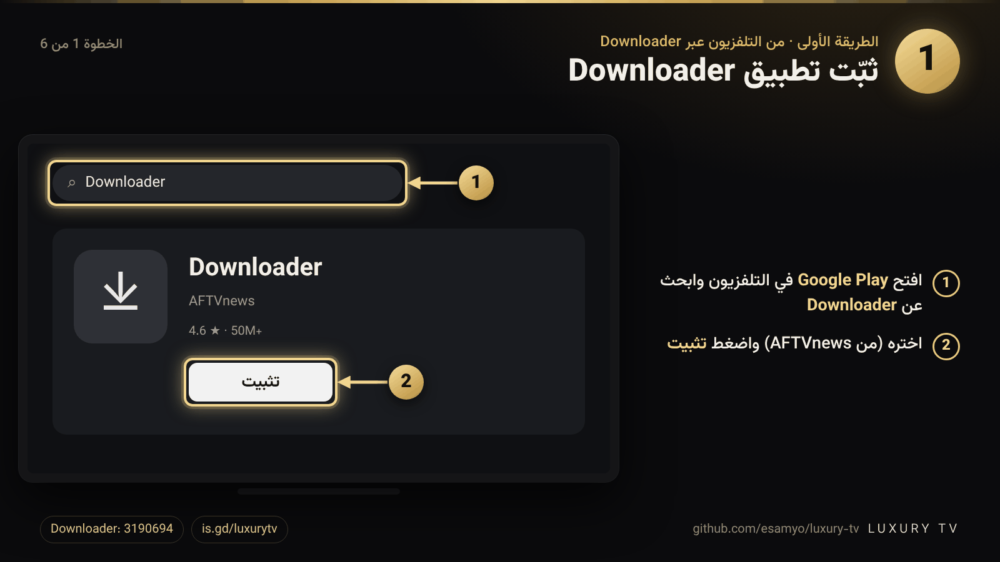

### 2. اسمح لـ Downloader بتثبيت التطبيقات
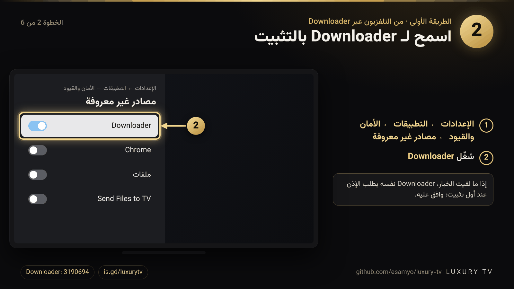

### 3. اكتب الكود واضغط Go
الكود: **`3190694`**، أو اكتب الرابط: **`is.gd/luxurytv`**

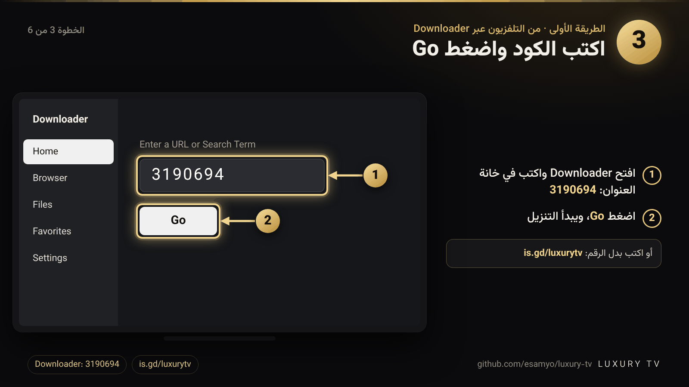

### 4. ثبّت Luxury TV
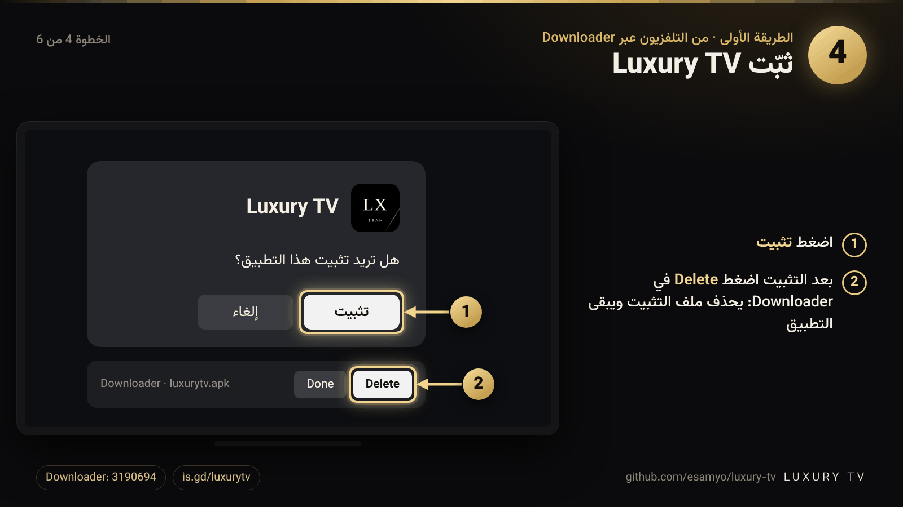

### 5. افتح Luxury TV
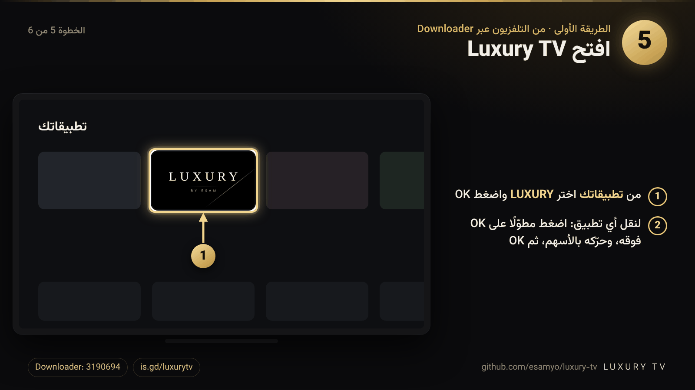

### 6. خفّف جهازك
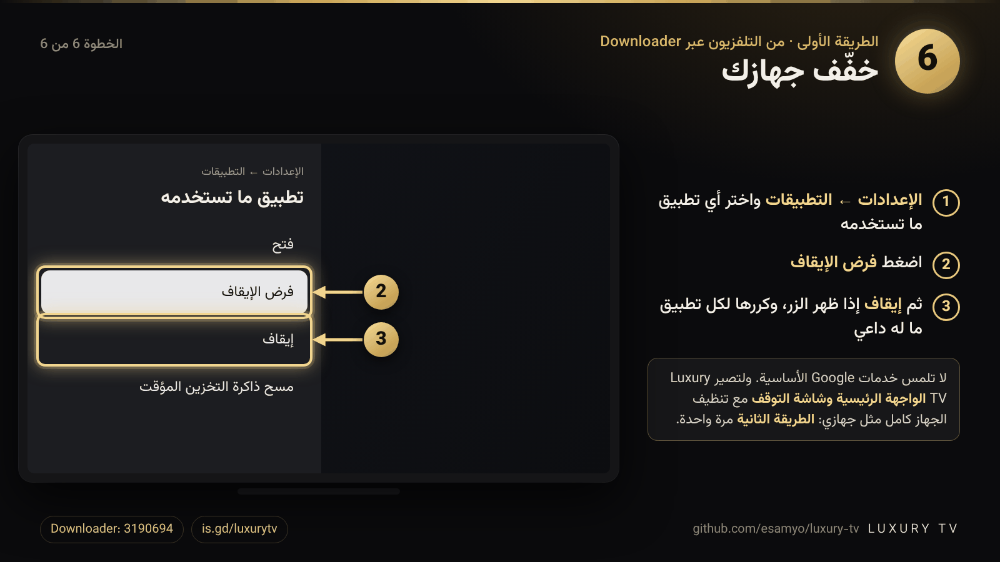

> في Google TV ما يسمح النظام لتطبيق من Downloader أن يصير **الواجهة الرئيسية** أو **شاشة التوقف** من الإعدادات.
> للتجربة الكاملة مثل جهازي: الطريقة الثانية، مرة واحدة فقط.

---

## الطريقة الثانية: من GitHub بمساعدة الذكاء الاصطناعي

### 1. افتح صفحة المشروع على GitHub
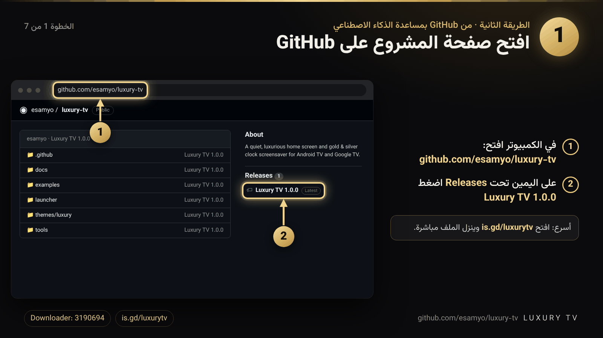

### 2. نزّل ملف التطبيق
أو افتح **`is.gd/luxurytv`** في متصفح الكمبيوتر وينزل الملف مباشرة.

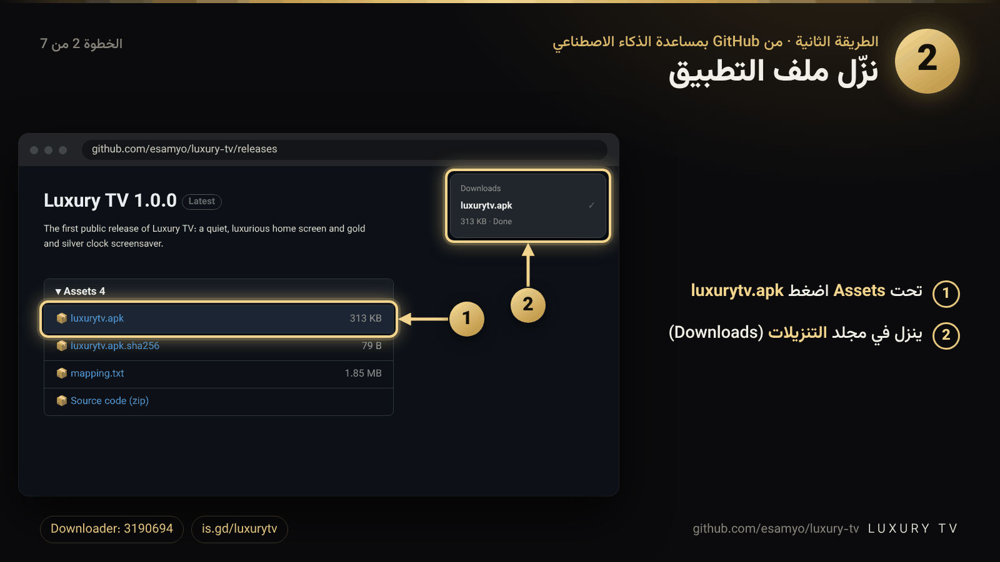

### 3. فعّل وضع المطوّر في التلفزيون
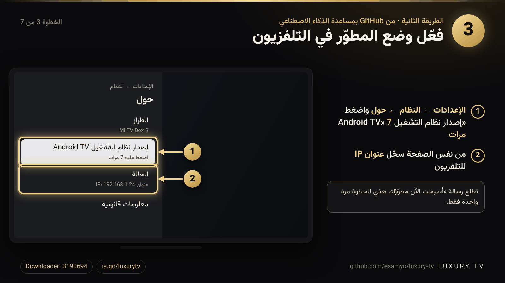

### 4. شغّل تصحيح الأخطاء
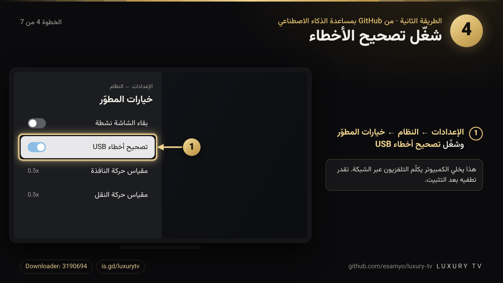

### 5. اطلب من المساعد يثبّتها
تحتاج مساعدًا **يقدر يشغّل أوامر على جهازك** (مثل Claude في تطبيق الكمبيوتر، أو ChatGPT مع وكيل يشغّل الأوامر).
انسخ الرسالة كما هي، وغيّر العنوان إلى عنوان تلفزيونك:

```
نزّل مشروع github.com/esamyo/luxury-tv واتبع ملف AGENTS.md فيه. ملف التطبيق luxurytv.apk موجود في مجلد التنزيلات. ثبّته على تلفزيوني وعنوانه 192.168.1.24، واجعله الواجهة الرئيسية وشاشة التوقف، واضبط مدينتي ولغتي، وعطّل التطبيقات اللي ما لها داعي بعد ما تعرض علي القائمة.
```

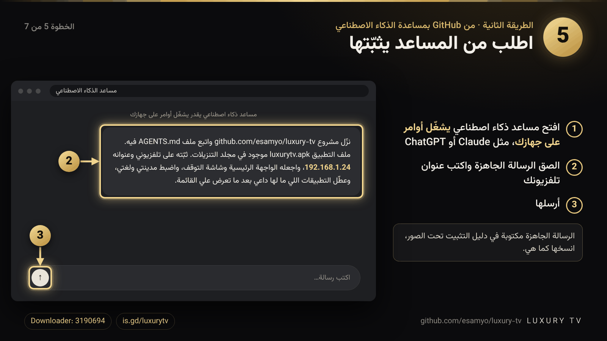

### 6. وافق على التلفزيون
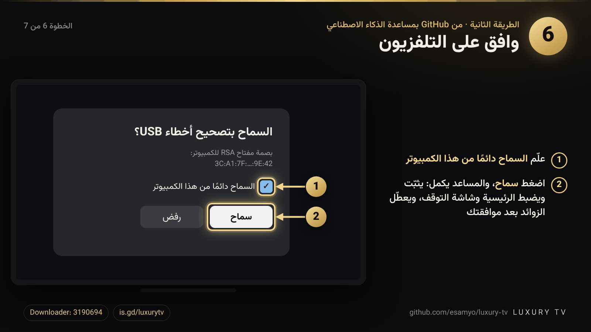

المساعد يكمل بنفسه، ويسألك قبل أي تغيير:
- يثبّت التطبيق، ويجعله الواجهة الرئيسية، ويضبط شاشة التوقف الذهبية والفضية.
- يضبط مدينتك ولغتك، فتطلع درجة الحرارة من أقرب مطار.
- يعرض عليك قائمة التطبيقات اللي ما لها داعي (إعلانات، وتتبع، وتطبيقات الشركة) ويعطّلها بعد موافقتك.
  التعطيل ما يحذف شيئًا، وكل تطبيق يرجع بأمر واحد.
- يخفّف الحركة إلى 0.5x ويوقف الخدمات اللي تشتغل في الخلفية بلا فائدة ([الإعدادات الخفيفة](light-settings.md)).

### 7. النتيجة


---

## إذا واجهتك مشكلة
- **ما يطلع Downloader في المتجر:** ابحث عن «Downloader AFTVnews»، أو ثبّته من متصفح التلفزيون.
- **زر الرئيسية يرجّعك للواجهة القديمة:** الطريقة الثانية تضبطه، أو اطلب من المساعد يتبع قسم «If something goes wrong» في
  [AGENTS.md](../AGENTS.md).
- **تبي ترجع كل شيء:** اطلب من المساعد: «رجّع التلفزيون مثل ما كان»، والطريقة مكتوبة له في AGENTS.md.

</div>
